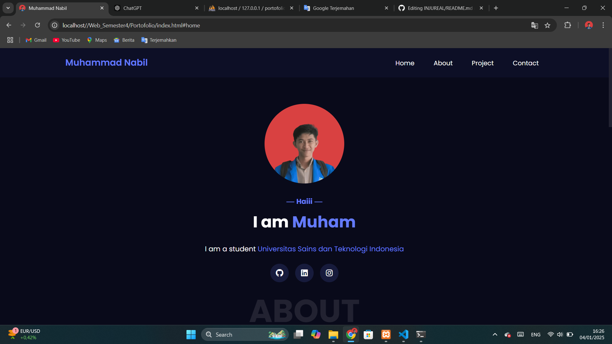

# Muhammad Nabil - Portofolio Website




## Deskripsi

Website portofolio pribadi untuk menampilkan profil, project, dan kontak Muhammad Nabil. Dibangun dengan HTML, CSS, dan JavaScript, serta dapat di-hosting di GitHub Pages.

## Fitur Utama

- Responsive design, tampilan modern
- Daftar project otomatis dari GitHub
- Form kontak lokal (data tersimpan di browser)
- Download CV
- Social media links

## Cara Menjalankan

1. Clone repository ini:
	```bash
	git clone https://github.com/Nabil17-alt/Portofolio.git
	```
2. Buka file `index.html` di browser, atau deploy ke GitHub Pages.

## Struktur Folder

- `index.html` - Halaman utama
- `index.js` - Script utama
- `index.css`, `style.css` - File CSS
- `pages/img/` - Gambar dan aset
- `pages/cv_nabil.pdf` - CV

## Kontak

- Email: realmuhammadnabil@gmail.com
- LinkedIn: [Muhammad Nabil](https://www.linkedin.com/in/muhammad-nabil-377629272/)

## Lisensi

Proyek ini dilisensikan di bawah MIT License. Lihat file [LICENSE](LICENSE) untuk detail.
